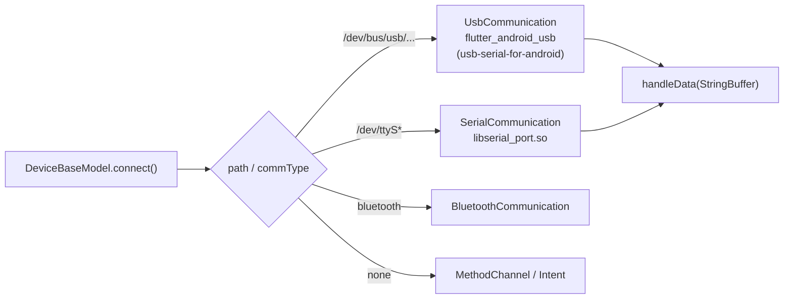

# MedLyves Medi-Kiosk: โปรโตคอลรับส่งข้อมูลของแต่ละอุปกรณ์ (v2)

> **แหล่งข้อมูล:** decompile `lib/arm64-v8a/libapp.so` ด้วย [blutter](https://github.com/worawit/blutter) (Dart 3.4.4, snapshot `d20a1be7…`) แล้วอ่าน asm/pseudo-code ของแพ็กเกจ `flutter_devices_sdk`, `flutter_android_usb`, `flutter_android_serial_port` และใช้ smali สำหรับส่วนที่เป็น Java (บัตรประชาชน, ECG)
>
> ✅ = ยืนยันจากโค้ดที่ decompile ได้ · ⚠️ = อนุมานจากโค้ดแต่ยังไม่ได้ทดสอบกับอุปกรณ์จริง
>
> v2 นี้มาแทน v1 ซึ่งเดาจาก string อย่างเดียว ส่วนที่ v1 ผิดสรุปไว้ใน [หัวข้อ 7](#7-สิ่งที่แก้จาก-v1)

---

## 1. โครงสร้างการสื่อสารที่ทุกอุปกรณ์ใช้ร่วมกัน ✅



| เรื่อง | รายละเอียด |
|---|---|
| การเลือก transport | ดูจาก prefix ของ path: `/dev/ttyS` ใช้ Serial, `/dev/bus/usb` ใช้ USB |
| Port config | `PortConfig(baud, dataBits=8, stopBits=1, parity=0)` → **8N1 เสมอ** มีแค่ baud ที่ต่างกัน |
| การส่ง | `sendCommand(Uint8List)` สร้าง byte จาก `HexUtils.convert2Bytes(str, "ascii" \| "hex")` หรือจาก const list |
| การรับ | สะสม byte ไว้ใน `StringBuffer` แล้วแปลงเป็น **hex string ตัวเล็ก** (หรือ ASCII สำหรับโปรโตคอลแบบ text) → `indexOf(header)` → `substring` ที่ offset คงที่ → `int.parse(radix: 16)` |
| Offset | ทุก offset ในเอกสารนี้นับเป็น **ตำแหน่งตัวอักษรใน hex string** (2 ตัวอักษร = 1 byte) นับจากต้น header ยกเว้นที่ระบุไว้เป็นอย่างอื่น |
| Serial (ttyS) | ต้อง root: native lib จะรัน `su` แล้ว `chmod 777 /dev/ttyS*` |

---

## 2. อุปกรณ์วัดสัญญาณชีพ

### 2.1 เครื่องวัดความดัน (Blood Pressure)

| ยี่ห้อ | Baud | คำสั่ง (TX) | การตอบกลับ (RX) | การ parse |
|---|---|---|---|---|
| **Panasonic** ✅ | 4800 (usb) | เริ่ม: ASCII `#BM0$`<br/>หยุด: `#BM1$` | ASCII `#BM…$` ยาว 15 ตัวอักษร | SYS=`[4:7]`, DIA=`[7:10]`, PULSE=`[10:13]` (ตัวเลขทศนิยมแบบ ASCII) |
| **Raycome** ✅ | 9600 | เริ่ม: `CC 80 03 03 01 02 00 03`<br/>หยุด: `CC 80 03 03 01 03 00 02` | header `aa80030f0106` | ค่าที่ hex `[28:30]`, `[32:34]`, `[36:38]` (SYS/DIA/PULSE) |
| **Cemho** ✅ | 115200 | เริ่ม: `BE B0 01 C0 36 E3 0B 01 08 0F 14`<br/>หยุด: `BE B0 01 C1 68 …` | header `d0c20ccc` | SYS=`[8:10]`, DIA=`[10:12]`, HR=`[12:14]` |

> คำสั่งของ Raycome ใช้ checksum แบบ XOR: `03^03^01^02^00 = 03` และ `03^03^01^03^00 = 02`

### 2.2 เครื่องวัดออกซิเจนในเลือด (SpO2)

| ยี่ห้อ | Baud | โหมด | Header / รูปแบบ | การ parse และ validation |
|---|---|---|---|---|
| **Nonin 3231** ✅ | 9600 | passive (รอรับอย่างเดียว) | regex `020a1[04]00` | SpO2=`[16:18]` (127 = ไม่ถูกต้อง, ใช้ได้ 50–100)<br/>Pulse=`[18:22]` (511 = ไม่ถูกต้อง, ใช้ได้ 18–321)<br/>ต้องได้ค่าที่ถูกต้อง 3 ครั้ง |
| **KeRuiKang** ✅ | 38400 | passive | `aa55530701` | SpO2=`idx+10..+12`, PR=`idx+12..+14`<br/>กรอง SpO2 80–100, เก็บ 6 ค่า ตัด min/max แล้วเฉลี่ย |
| **OXIMETER** ✅ | – | passive | `fe100184` | ค่าที่ `[8:10]`, `[12:14]`; 255 = ไม่ถูกต้อง; SpO2 85–100; ใช้ 3 ค่า |
| **ChengDu** ✅ | 4800 | polling | ส่ง ASCII `#XM0$` ซ้ำเรื่อย ๆ → ตอบ `#XMC0` ตามด้วยตัวเลข 2 หลัก | `substring(5,7)` เป็นทศนิยม, ใช้ได้ 50–100 |

### 2.3 เครื่องวัดอุณหภูมิ

| ยี่ห้อ | Baud | TX | RX | การ parse |
|---|---|---|---|---|
| **ChengDu DT8861** ✅ | 4800 | `#TM0$` | `#TM` + 3 หลัก + `$` (7 ตัวอักษร) | `[3:6] / 10` → °C |
| **DT8861** ✅ | 4800 | passive | header `ff00` → ค่าที่ตามมา / 10<br/>`ff01` → 0.0 | hex |
| **URION** ✅ | 9600 | passive | frame 8 byte | `[8:12] / 10` |

### 2.4 ส่วนสูง / น้ำหนัก

| อุปกรณ์ | Transport | TX | RX | การ parse |
|---|---|---|---|---|
| **ShengYuan ส่วนสูง** ✅ | serial `/dev/ttyS`, 4800 | `#SM0$` เริ่ม / `#SM1$` หยุด | `#SMH1` + 4 หลัก | / 10 → cm |
| **ShengYuan น้ำหนัก** ✅ | serial, 4800 | เหมือนด้านบน | `#SMW1` + 4 หลัก | / 10 → kg |
| **ZhongKe CQRF / Microwave ส่วนสูง** ✅ | usb, 4800 | `MS026$` เริ่ม / `MT$` หยุด | `M…` (Microwave ใช้ regex `[MN]`) | **ส่วนสูง = ความสูงที่ตั้งไว้ใน DeviceSdkParamSetting (height1/2/3) − ระยะที่เซนเซอร์วัดได้**<br/>วัด 3 ครั้ง เรียงลำดับแล้วใช้ค่ากลาง, เขียน log เป็น CSV, มีตัวเลือก `use_original_data` |
| **ZhongKe ThreeInOne** ✅ | 9600 | เริ่ม `A5 0B 27 A0 09 "MS025$" 88 AA`<br/>หยุด `A5 08 27 A0 09 "MT$" BB AA` | header `a50b27094d` | ค่าที่ `[10:20]` |
| **BoRuiWei DG861 น้ำหนัก** ✅ | 9600 | `A5 07 27 A0 02 FF FF 82 AA` | header `a50f2702` | status=`[8:10]` (ทศนิยม): 4=ไม่มีน้ำหนัก, 5/6/7=OK, 8=weighing-off, 9=เกินพิกัด<br/>น้ำหนัก=`[12:16] / 10 / 2` (หน่วยจิน → kg) |

---

## 3. Body Composition (วิเคราะห์องค์ประกอบร่างกาย)

### 3.1 รูปแบบ frame `A5 … AA` ของ BoRuiWei/ZhongKe ✅

```
A5 | LEN | 27 | CMD | payload … | CHK | AA
```
- `LEN` = จำนวน byte ทั้งหมดไม่รวม `A5` และ `AA` (ตรวจแล้ว: `A5 07 …` มี 7 byte ตรงกลาง)
- `CMD`: `A0` = สั่งงาน, `F0` = ส่งข้อมูลผู้ใช้ (**เป็นรหัสคำสั่ง ไม่ใช่ทิศทาง**)
- `CHK` = **XOR ของทุก byte ตั้งแต่ LEN ถึง byte ก่อน CHK** (ตรวจกับคำสั่งจริงแล้ว 4 ชุด ตรงทั้งหมด)

### 3.2 BoRuiWei DG861 (4 ขั้วไฟฟ้า) ✅ 9600

1. **วัดอิมพีแดนซ์:** `A5 07 27 A0 03 05 01 87 AA` → ตอบ frame `a50f27` ค่าอิมพีแดนซ์อยู่ที่ `idx+0x12..+0x16` ช่วงที่รับได้ **200–1200 Ω** ถ้าอยู่นอกช่วงจะแจ้งให้วัดใหม่
2. **ส่งข้อมูลผู้ใช้:** `A5 0A 27 F0 <gender> 00 <age> <height> <weight×10 hi> <lo> <XOR> AA`
3. **ผลลัพธ์:** frame `a5132740` **ตัวเครื่องเป็นผู้คำนวณ** แอปแค่แยกค่าออกมา:

| ตำแหน่ง hex | การแปลง | ความหมาย (ลำดับตาม log ของแอป) ⚠️ |
|---|---|---|
| `[8:12]` | /10 | Body fat % |
| `[12:16]` | /10 | Water % |
| `[16:20]` | /10 | Muscle |
| `[20:22]` | /10 | Bone |
| `[22:26]` | – | BMR |
| `[26:28]` | – | Visceral fat |
| `[28:30]` | – | Body age |
| `[30:34]` | /10 | ECW |
| `[34:38]` | /10 | ICW |

ค่าอย่าง Protein และ Fat mass แอปคำนวณต่อจากค่าข้างบน

### 3.3 BoRuiWei 8 ขั้วไฟฟ้า (segmental) ✅ 9600, usb

ใช้ frame A5 แบบเดียวกัน แต่ข้างในห่อ **โปรโตคอลชั้นในที่ขึ้นต้นด้วย `55`** (ฝั่ง TX) / `AA` (ฝั่ง RX) โดยมีโมดูล BIA อยู่ด้านหลังบอร์ดชั่ง (`0F 02` = route ไปยังโมดูลนั้น ⚠️)

| ขั้นตอน | คำสั่ง TX |
|---|---|
| Init / reset | `A5 0C 27 A0 0F 02 55 06 B0 04 03 EE 8C AA` |
| วัดอิมพีแดนซ์ความถี่ 1 (20 kHz ⚠️) | `A5 0B 27 A0 0F 02 55 05 B1 61 94 95 AA` |
| วัดอิมพีแดนซ์ความถี่ 2 (100 kHz ⚠️) | `A5 0B 27 A0 0F 02 55 05 B1 31 C4 95 AA` |
| ขอผล | `A5 0B 27 A0 0F 02 55 05 B2 00 F4 97 AA` |
| ส่งข้อมูลผู้ใช้ + อิมพีแดนซ์ | สร้างโดย `_buildBodyCompositionCmd` จาก gender/age/height/weight และค่าอิมพีแดนซ์ 5 ส่วน |

| Header ที่รับ | ความหมาย |
|---|---|
| `aa1bb1` | ผลอิมพีแดนซ์ของ rightHand, leftHand, trunk, rightFoot, leftFoot (log บอกว่าเป็น 20 kHz หรือ 100 kHz) |
| `aa50d05100` | ผลองค์ประกอบร่างกาย package 1 (ยาว 0xA0 ตัวอักษร hex = 80 byte) |
| `aa3ad05300` | package 3 (ยาว 0x74 ตัวอักษร hex = 58 byte) |
| `aa06b2…` / `aa06b200009e` | สถานะ/ACK ของคำสั่ง B2 |
| `aa05b000a1` | ACK ของคำสั่ง init |

- ตัวเลขเป็น **little-endian** (`_littleEndianToInt`)
- มีโหมด `only_test_impedance` ที่วัดอิมพีแดนซ์อย่างเดียว
- checksum ของโปรโตคอลชั้นใน (`calculateChecksum`) ไม่ใช่ XOR หรือผลรวมธรรมดา ⚠️ ถ้าจะใช้ให้คัดลอก byte จากตารางด้านบนไปตรง ๆ

### 3.4 ChengDu / ShengYuan ✅ 4800

- คำสั่ง ASCII: `#FM` + gender (ChengDu ใช้ 2 หลัก / ShengYuan ใช้ M หรือ W) + age + height×10 (4 หลัก) + weight×10 (4 หลัก) + `$`
- ตอบกลับเป็น `#FM…$` แล้ว parse จากตำแหน่งตัวอักษรคงที่ ส่วนใหญ่หารด้วย 10

---

## 4. Lab analyzer และเครื่องอ่าน (รับเป็นข้อความ text)

| อุปกรณ์ | Baud | รูปแบบ |
|---|---|---|
| **SG Diagnostics** ✅ (**เป็นเครื่อง HbA1c ไม่ใช่เครื่องวัดน้ำตาล**) | 9600 passive | รายงานแบบ text แยกบรรทัดด้วย `\r` แล้วอ่าน `IFCC … mmol/mol` และ `eAG … mmol/L` |
| **PreciSC Lipid** ✅ | 9600 passive | รายงานแบบ text: ID, CHOL, HDL, TRIG, LDL (mg/dL), CHOL/HDL |
| **XK scanner / YouKu EP8280** ✅ | 9600 passive | ข้อความแยกด้วย `\r\n` → `CodeScannerData` |

---

## 5. อุปกรณ์ควบคุม (relay / มอเตอร์ / เครื่องพิมพ์ / ตู้จ่าย)

### 5.1 SmartHub (USB hub ที่สั่งเปิด/ปิดไฟได้) ✅ 115200, usb
คำสั่งเป็น **ASCII text**:
```
alloff\n            ← ปิดทุกพอร์ต
onoff <port> 1\n    ← เปิดพอร์ต
```
- index ของแอปแปลงเป็นพอร์ตจริงด้วย `[5,4,3,2,1,0,11,10,9,8,7,6]` (มีทั้งหมด 12 พอร์ต)
- delay ก่อนเริ่มของแต่ละพอร์ตอ่านจาก settings (หน่วยวินาที ×1000)

### 5.2 ZhongSheng Relay ✅ Modbus RTU func 06 (Write Single Register)

| คำสั่ง | Frame (คำนวณ CRC16-Modbus แล้ว) |
|---|---|
| ปิดทั้งหมด | `01 06 00 34 00 00 C8 04` |
| เปิดช่อง addr 0 | `01 06 00 00 00 01 48 0A` |
| เปิดช่อง addr 1 | `01 06 00 01 00 01 19 CA` |
| รูปแบบทั่วไป | `01 06 00 <addr> 00 01 <CRC lo> <CRC hi>` |

- รุ่น Serial: 38400 บน `/dev/ttyS*`
- รุ่น USB: 38400 แอปจะไล่หาอุปกรณ์ ("device count" / "connect device index")
- `UsbRelayControl` โหลดค่าจาก `/devices/<x>_config.json` (`deviceType`, `start_wait_time_s`)

### 5.3 YanMeng IO (มอเตอร์แท่นขึ้น/ลง) ✅ 9600, Modbus RTU func 05 (Write Single Coil)

| คำสั่ง | ลำดับ |
|---|---|
| ลง | `01 05 00 00 00 00 CD CA` → รอ 1 วินาที → `01 05 00 00 FF 00 8C 3A` |
| ขึ้น | `01 05 00 01 00 00 9C 0A` → รอ 1 วินาที → `01 05 00 01 FF 00 DD FA` |

(คำนวณ CRC ใหม่แล้ว ตรงกับค่าในแอปทุกชุด)

### 5.4 Dispenser M108 (ตู้จ่ายของ) ✅/⚠️ serial `/dev/ttyS1`, 9600
- frame ตอบกลับขึ้นต้นด้วย `1B 10` และจบด้วย `0D 0A`
- byte ประเภทอยู่ที่ `idx+10..+12` แล้วแยกเป็นกรณี 1–7, 9, 10, 0x20 ไปที่ handler ต่าง ๆ:
  - `dealBoardSoftwareInfo` (ข้อมูลบอร์ด)
  - `dealBoardWorkStatus` (สถานะการทำงาน)
  - `setCargoWayMotorControlResult` (ผลสั่งมอเตอร์ช่องสินค้า)
  - `setCargoWayLedControlResult` (ผลสั่ง LED)
- ยังไม่ได้ถอดรายละเอียดคำสั่ง TX ของรุ่นนี้

### 5.5 เครื่องพิมพ์
- **XK printer** ✅: `commType = "none"` ส่งงานผ่าน MethodChannel (`updatePath`, `print`) ไปที่ฝั่ง Java
- **Yokoscan EM5826** ⚠️: 115200 แต่โค้ดคำสั่งเริ่มถูก Dart tree-shaking ลบออกไปแล้ว จึงไม่มีให้ดู

### 5.6 การตรวจลำดับ USB (`DeviceOrderCheck`) ✅
- เทียบ VID:PID กับ config (`origin-vid-pid` / `new-vid-pid`) ถ้าไม่ตรงจะขึ้น `Error:` (error 003 บนหน้าจอ)
- `checkRelayDeviceLost` ตรวจว่ายังมี relay ที่อยู่บน `/dev/ttyS` ครบหรือไม่

---

## 6. อุปกรณ์ที่ไม่ได้ใช้ serial ✅ (จาก smali)

| อุปกรณ์ | วิธี |
|---|---|
| **บัตรประชาชนไทย** (PC/SC, CCID) | SELECT `00 A4 04 00 08 A0 00 00 00 54 48 00 01` จากนั้น `80 B0 <off> 02 00 <len>` + `00 C0 00 00 <len>` ข้อความเข้ารหัสเป็น TIS-620 (ตารางอยู่ใน `smali*/K1/f.smali`) ⚠️ คำสั่ง cardIssuer ได้ค่า `01 F6` ซึ่งต่างจากที่พบทั่วไป (`00 F6`) |
| **MyKad (มาเลเซีย)** | SELECT `00 A4 04 00 0A A0 00 00 00 74 4A 50 4E 00 10` แล้วอ่านด้วย `CC 06 00 00 <Le>` |
| **ECG (Huaqing)** | ส่ง Intent ไปที่แอป `com.ecgmac.ecgtab` แล้วอ่านผลจากไฟล์ใน `/ECGDATA/` |

---

## 7. สิ่งที่แก้จาก v1

| v1 (ผิด) | v2 (ถูกต้อง) |
|---|---|
| frame `A5…AA` เป็นของ SmartHub | เป็นของ **BoRuiWei / ZhongKe ThreeInOne** ส่วน SmartHub ใช้ text `alloff` / `onoff` |
| `A0` / `F0` คือทิศทางการส่ง | เป็น **รหัสคำสั่ง** |
| Modbus func 05 เป็นของ ZhongSheng relay | เป็นของ **มอเตอร์แท่น YanMeng** ส่วน ZhongSheng ใช้ **func 06** |
| ไม่รู้ว่าคำสั่ง BP เป็นของยี่ห้อไหน | Panasonic=`#BM`, Raycome=`CC 80`, Cemho=`BE B0` |
| แอปคำนวณ body fat เอง (DG861) | **ตัวเครื่องคำนวณ** แอปแค่ parse |
| SG Diagnostics = เครื่องวัดน้ำตาลในเลือด | เป็น **เครื่องวิเคราะห์ HbA1c** |

## 8. สิ่งที่ยังไม่รู้
- ความหมายของบาง field ในตาราง 3.2 อิงจากลำดับใน log ⚠️ ควรยืนยันกับเครื่องจริง
- อัลกอริทึม checksum ชั้นในของรุ่น 8 ขั้ว และ layout ของ package `aa50d051` / `aa3ad053`
- คำสั่ง TX ของ Dispenser M108 และคำสั่งเริ่มของ Yokoscan
- หากต้องการดูข้อมูลขณะรันจริง ใช้ `D:\re\out\blutter_frida.js` กับ Frida hook ที่ `sendCommand` / `handleData` ได้
