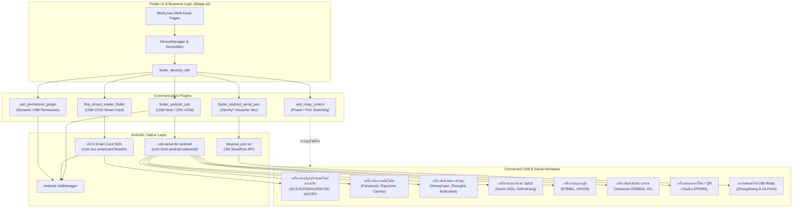
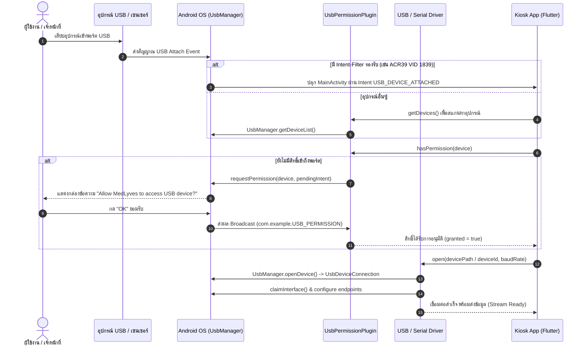

# รายงานการวิเคราะห์การเชื่อมต่ออุปกรณ์ภายนอกผ่าน USB / Serial
**แอปพลิเคชัน:** MedLyves Medi-Kiosk (`com.medlyves.simple_kiosk_software`)  
**แพลตฟอร์ม:** Android (สร้างด้วย Flutter Framework)

---

## 1. ภาพรวมสถาปัตยกรรม (System Architecture)

แอปพลิเคชันเป็นระบบซอฟต์แวร์สำหรับตู้คีออสตรวจสุขภาพอัจฉริยะ (Smart Health Kiosk) ซึ่งต้องทำงานร่วมกับอุปกรณ์ทางการแพทย์ เซนเซอร์ตรวจวัด บอร์ดรีเลย์ และเครื่องอ่านบัตรประชาชนพร้อมกันจำนวนมาก ระบบจัดการการเชื่อมต่อฮาร์ดแวร์ภายนอกผ่านสถาปัตยกรรมแบบ Modular โดยมีปลั๊กอินเฉพาะทางแยกตามชนิดของโปรโตคอล



---

## 2. วิธีการเชื่อมต่ออุปกรณ์ผ่าน USB (4 รูปแบบหลัก)

จากการตรวจสอบซอร์สโค้ดและ Smali Classes พบว่าแอปพลิเคชันแบ่งรูปแบบการสื่อสารทางกายภาพออกเป็น 4 รูปแบบ:

### รูปแบบที่ 1: Android USB Host Mode (USB-to-Serial / CDC-ACM)
ใช้สำหรับอุปกรณ์วัดทางการแพทย์ส่วนใหญ่ เช่น เครื่องวัดความดัน, เครื่องชั่งน้ำหนัก, เครื่องวัดออกซิเจน, และเครื่องพิมพ์สลิป

* **คลาสที่ดูแล:** [`Li3/c.smali`](file:///c:/Users/INSOMNIA/Downloads/Simple-Kiosk-Norn-Horm-TH-20260827%20%281%29/smali/i3.1/c.smali) และ [`Li3/e.smali`](file:///c:/Users/INSOMNIA/Downloads/Simple-Kiosk-Norn-Horm-TH-20260827%20%281%29/smali/i3.1/e.smali)
* **ไลบรารีเบื้องหลัง:** `com.hoho.android.usbserial` (Mik3y `usb-serial-for-android`)
* **ขั้นตอนการทำงาน:**
  1. แอปเรียก `UsbManager.getDeviceList()` เพื่อค้นหาอุปกรณ์ที่ต่ออยู่
  2. เปิดการเชื่อมต่อผ่าน `UsbManager.openDevice(UsbDevice)` ได้รับอินสแตนซ์ `UsbDeviceConnection`
  3. ค้นหาและสร้างไดรเวอร์ผ่าน `UsbSerialProber.getDefaultProber().probeDevice(device)` (รองรับชิปแปลง USB-to-UART ทั่วไป เช่น FTDI FT232, Silicon Labs CP210x, QinHeng CH340/CH341, Prolific PL2303)
  4. **Fallback อัจฉริยะ:** หากไม่พบในฐานข้อมูล Prober จะเปลี่ยนไปเปิดด้วย `CdcAcmSerialDriver` (Universal CDC-ACM) โดยอัตโนมัติ
  5. ปรับตั้งค่า Baudrate, DataBits, StopBits, Parity ผ่าน MethodChannel:
     ```dart
     await port.setPortParameters(baudRate, dataBits, stopBits, parity);
     ```
  6. สื่อสารข้อมูลแบบ Two-way Asynchronous:
     - **ส่งข้อมูล (TX):** ผ่าน Method `write` (รับข้อมูล `Uint8List`)
     - **รับข้อมูล (RX):** ผ่าน EventChannel ชื่อ `usb_serial_for_android/UsbSerialPortAdapter/{portId}/stream`

---

### รูปแบบที่ 2: USB Smart Card Reader (CCID Protocol)
ใช้สำหรับเครื่องอ่านบัตรประชาชนไทย (Thai National ID Card) และบัตรมาเลเซีย (MyKad) เพื่อยืนยันตัวตนผู้ใช้

* **คลาสที่ดูแล:** [`LK1/g.smali`](file:///c:/Users/INSOMNIA/Downloads/Simple-Kiosk-Norn-Horm-TH-20260827%20%281%29/smali/K1/g.smali) และ [`LK1/f.smali`](file:///c:/Users/INSOMNIA/Downloads/Simple-Kiosk-Norn-Horm-TH-20260827%20%281%29/smali/K1/f.smali)
* **ไลบรารีเบื้องหลัง:** ACS Smart Card SDK ([`LI1/j.smali`](file:///c:/Users/INSOMNIA/Downloads/Simple-Kiosk-Norn-Horm-TH-20260827%20%281%29/smali/I1/j.smali) - `com.acs.smartcard.Reader`)
* **การระบุอุปกรณ์ (Vendor ID):**
  - ในไฟล์ [`device_filter.xml`](file:///c:/Users/INSOMNIA/Downloads/Simple-Kiosk-Norn-Horm-TH-20260827%20%281%29/res/xml/device_filter.xml) มีการระบุ:
    ```xml
    <usb-device vendor-id="1839" />
    ```
  - ค่า `1839` ในฐานสิบ เทียบเท่ากับ **`0x072F`** ในฐานสิบหก ซึ่งเป็น Vendor ID ของ **Advanced Card Systems Ltd. (ACS)** เช่น รุ่น ACR38, ACR39, ACR122U
* **การอ่านข้อมูลบัตรประชาชนไทย:**
  - สื่อสารผ่านคำสั่ง **APDU (Application Protocol Data Unit)**
  - ถอดรหัสชุดตัวอักษรด้วย **`TIS620`** (Thai Industrial Standard)
  - ข้อมูลที่ถูกดึงออกมา:
    - เลขประจำตัวประชาชน 13 หลัก (`cid`)
    - ชื่อ-สกุล ภาษาไทยและภาษาอังกฤษ (`nameTH`, `nameEN`)
    - วันเดือนปีเกิด (`birthdate`) และเพศ (`gender`)
    - ที่อยู่ตามทะเบียนราษฎร์ (`address`)
    - ข้อมูลผู้ออกบัตร วันออกบัตร และวันหมดอายุ (`cardIssuer`, `issueDate`, `expireDate`)
    - รูปถ่ายหน้าตรงเจ้าของบัตร (`photo`) เป็น Binary Array

---

### รูปแบบที่ 3: Native Linux Serial Port (`/dev/tty*`)
ใช้สำหรับบอร์ดคอมพิวเตอร์อุตสาหกรรมในตู้ Kiosk ที่มีพอร์ต RS-232/UART บนเมนบอร์ด หรือผ่านไดรเวอร์ระดับ Kernel ที่แม็พเป็น Character Device

* **คลาสที่ดูแล:** [`Lh3/a.smali`](file:///c:/Users/INSOMNIA/Downloads/Simple-Kiosk-Norn-Horm-TH-20260827%20%281%29/smali/h3.1/a.smali)
* **ไฟล์ Native Binary:** [`libserial_port.so`](file:///c:/Users/INSOMNIA/Downloads/Simple-Kiosk-Norn-Horm-TH-20260827%20%281%29/lib/arm64-v8a/libserial_port.so) (`android_serialport_api`)
* **จุดเด่นในการทำงาน:**
  1. ระบุพอร์ตโดยตรง เช่น `/dev/ttyS1`, `/dev/ttyS4`, หรือ `/dev/ttyUSB0`
  2. **ระบบ Auto-Root Chmod:** หากเปิดพอร์ตแล้วเจอปัญหา Permission Denied ใน Android โค้ดจะเรียก Shell คำสั่ง Root:
     ```sh
     /system/xbin/su
     chmod 777 /dev/ttyS*
     ```
  3. สื่อสารผ่าน JNI Function `Java_android_serialport_SerialPort_open(devicePath, baudRate, flags)`

---

### รูปแบบที่ 4: การควบคุมไฟและรีเซ็ตอุปกรณ์ผ่าน USB Relay / Smart Hub
ตู้ Kiosk ออกแบบมาให้มีอุปกรณ์การแพทย์จำนวนมากต่อพ่วงอยู่ หากเปิดพร้อมกันตลอดเวลาอาจเกิดปัญหาสัญญาณรบกวนหรือไฟเลี้ยง USB Hub ดร็อป จึงมีระบบ Relay สวิตช์ตัดต่อไฟรายพอร์ต

* **คลาสที่ดูแล:**
  - `SmartHubDevice`
  - `ZhongShengUsbRelayDevice`
  - `ZhongShengSerialRelayDevice`
  - `UsbRelayControl`
* **กลไกการควบคุม:**
  - รองรับรีเลย์ควบคุมไฟตั้งแต่ 8 ถึง 16 ช่อง IO (`relay_io_count`)
  - เมื่อผู้ใช้เข้าสู่หน้าจอการตรวจใดๆ เช่น `/BloodPressureMeasure` แอปจะสั่งเปิดรีเลย์เฉพาะช่องที่จ่ายไฟให้เครื่องวัดความดัน
  - มีระบบตรวจเช็คอุปกรณ์ขาดการเชื่อมต่อ (`checkRelayDeviceLost`, `waitFindUsbRelay`) และหน่วงเวลารอเปิดเครื่อง (`initRelayIoStartTime`)

---

## 3. ขั้นตอนการขอสิทธิ์และการตรวจจับ USB (Lifecycle & Permissions)



---

## 4. รายการอุปกรณ์ทางการแพทย์และเซนเซอร์ทั้งหมดในระบบ

จากการแกะสัญลักษณ์ใน [`libapp.so`](file:///c:/Users/INSOMNIA/Downloads/Simple-Kiosk-Norn-Horm-TH-20260827%20%281%29/lib/arm64-v8a/libapp.so) จากแพ็กเกจ `flutter_devices_sdk` ตรวจพบไดรเวอร์ของอุปกรณ์ต่างๆ ดังนี้:

| หมวดหมู่การตรวจ | แบรนด์ / รุ่นที่ระบุในโค้ด | คลาสไดรเวอร์ (Dart Class) | ลักษณะการเชื่อมต่อ |
| :--- | :--- | :--- | :--- |
| **อ่านบัตรประชาชน** | ACS Smart Card (ACR38 / ACR39) | `ThaiCard`, `MalaysiaCard` | USB CCID / APDU (VID: `1839`) |
| **ความดันโลหิต** | **Panasonic**<br>**Raycome** (Pulsewave)<br>**Cemho** | `PanasonicBloodPressureDevice`<br>`RaycomeBloodPressureDevice`<br>`CemhoBloodPressureDevice` | USB-to-Serial / Serial Port |
| **ระดับน้ำตาล / สารเคมีในเลือด** | **SG Diagnostics**<br>**PreciSC** Blood Fit | `SGDianosticsBloodGlucoseDevice`<br>`PreciSCBloodFitDevice` | USB-to-Serial |
| **ความอิ่มตัวออกซิเจน SpO2** | **Nonin** 3231<br>**KeRuiKang**<br>**ChengDu** Oximeter | `Nonin3231_BloodOxygenDevice`<br>`KeRuiKangBloodOxygenDevice`<br>`ChengDuBloodOxygenDevice` | USB-to-Serial / Bluetooth |
| **อุณหภูมิร่างกาย** | **DT8861** (ChengDu Infrared)<br>**URION** Thermometer | `DT8861TemperatureDevice`<br>`URIONTemperatureDevice` | USB-to-Serial |
| **น้ำหนักและส่วนสูง** | **ShengYuan** (Omron OEM)<br>**ZhongKe CQRF** (Microwave/Ultrasonic)<br>**BoRuiWei** (DG861) | `ShengYuanHeightDevice`<br>`ShengYuanWeightDevice`<br>`ZhongKeCQRFHeightDevice`<br>`BoRuiWeiDG681WeightDevice` | Serial Port (`/dev/ttyS*`) หรือ USB-to-Serial |
| **องค์ประกอบร่างกาย (Body Fat)** | **BoRuiWei** (8 Electrodes BIA)<br>**ChengDu** Body Composition | `BoRuiWei8ElectrodesCompositionDevice`<br>`ChengDuBodyCompositionDevice` | USB-to-Serial |
| **คลื่นไฟฟ้าหัวใจ (ECG)** | **Huaqing Xinyi** ECG<br>**ECGMAC** Tablet | `HuaqingxinyiEcgDevice`<br>`com.ecgmac.ecgtab` | USB-to-Serial / Android App Intent |
| **พิมพ์ใบเสร็จ/สลิป** | **Yokoscan** EM5826 Thermal Printer<br>**XK** Printer | `YokoscanEM5826PrinterDevice`<br>`XKPrinterDevice` | USB Direct / ESC-POS Command |
| **สแกนบาร์โค้ด / QR** | **YouKu** EP8280 2D Scanner<br>**XK** Scanner | `YouKuEP8280CodeScannerDevice`<br>`XKScannerDevice` | USB Virtual COM / HID-POS |
| **ควบคุมตู้ / มอเตอร์ปรับเสา** | **Yanmeng** IO Board<br>**ZhongSheng** USB Relay | `YanmengIODevice`<br>`ZhongShengUsbRelayDevice`<br>`UpDownControl` | Relay Control via USB/RS-232 |

---

## 5. แฟ้มและไฟล์โค้ดหลักที่เกี่ยวข้องในโปรเจกต์

* [`AndroidManifest.xml`](file:///c:/Users/INSOMNIA/Downloads/Simple-Kiosk-Norn-Horm-TH-20260827%20%281%29/AndroidManifest.xml) — สิทธิ์ `android.permission.USB_PERMISSION`, ฟีเจอร์ `android.hardware.usb.host` และ Intent-filter ตรวจจับ USB Attach
* [`res/xml/device_filter.xml`](file:///c:/Users/INSOMNIA/Downloads/Simple-Kiosk-Norn-Horm-TH-20260827%20%281%29/res/xml/device_filter.xml) — ฟิลเตอร์ตรวจจับเครื่องอ่านบัตรประชาชน ACS (Vendor ID `1839`)
* [`GeneratedPluginRegistrant.smali`](file:///c:/Users/INSOMNIA/Downloads/Simple-Kiosk-Norn-Horm-TH-20260827%20%281%29/smali/io/flutter/plugins/GeneratedPluginRegistrant.smali) — จุดลงทะเบียนปลั๊กอินฮาร์ดแวร์ทั้งหมดของ Flutter
* [`smali/K1/g.smali`](file:///c:/Users/INSOMNIA/Downloads/Simple-Kiosk-Norn-Horm-TH-20260827%20%281%29/smali/K1/g.smali) — โค้ดเชื่อมต่อเครื่องอ่านบัตรประชาชนไทย
* [`smali/i3.1/c.smali`](file:///c:/Users/INSOMNIA/Downloads/Simple-Kiosk-Norn-Horm-TH-20260827%20%281%29/smali/i3.1/c.smali) — โค้ดเปิดพอร์ต USB Host และ CDC-ACM Serial
* [`smali/h3.1/a.smali`](file:///c:/Users/INSOMNIA/Downloads/Simple-Kiosk-Norn-Horm-TH-20260827%20%281%29/smali/h3.1/a.smali) — โค้ดเปิดพอร์ต `/dev/tty*` พร้อมฟังก์ชัน Root Chmod
* [`smali/L1/a.smali`](file:///c:/Users/INSOMNIA/Downloads/Simple-Kiosk-Norn-Horm-TH-20260827%20%281%29/smali/L1/a.smali) — โค้ดขอยกเว้นและอนุญาตสิทธิ์ USB
* [`lib/arm64-v8a/libserial_port.so`](file:///c:/Users/INSOMNIA/Downloads/Simple-Kiosk-Norn-Horm-TH-20260827%20%281%29/lib/arm64-v8a/libserial_port.so) — ไบนารี C/C++ สำหรับจัดการ Linux Serial File Descriptor
* [`lib/arm64-v8a/libapp.so`](file:///c:/Users/INSOMNIA/Downloads/Simple-Kiosk-Norn-Horm-TH-20260827%20%281%29/lib/arm64-v8a/libapp.so) — โค้ดไบนารี AOT ของ Flutter รวมตรรกะไดรเวอร์เครื่องมือแพทย์ทั้งหมด (`flutter_devices_sdk`)
